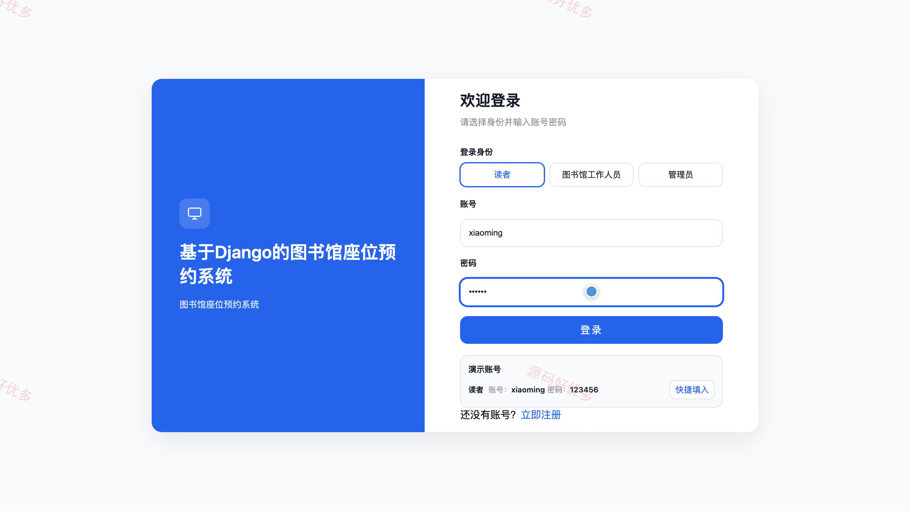
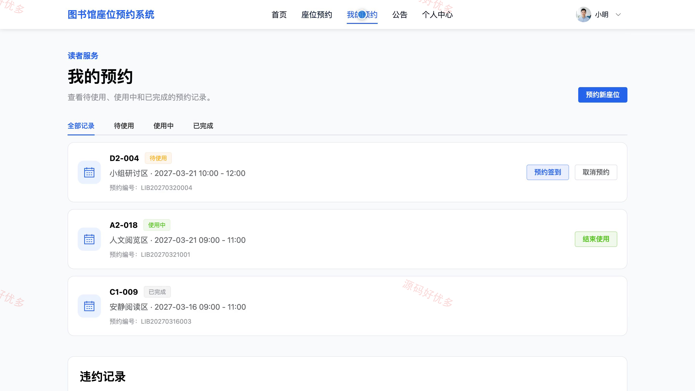
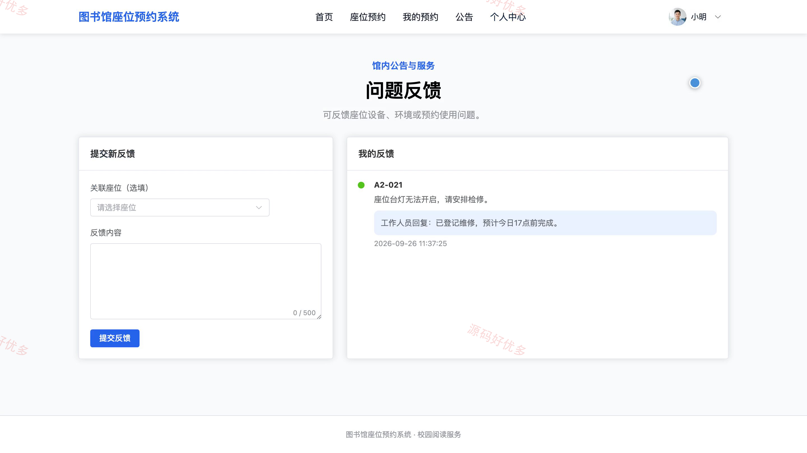
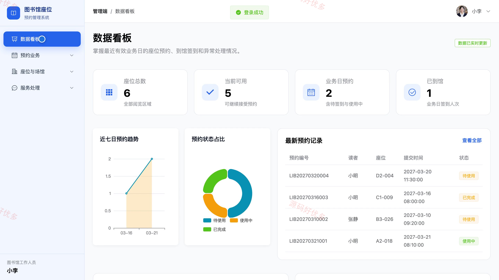
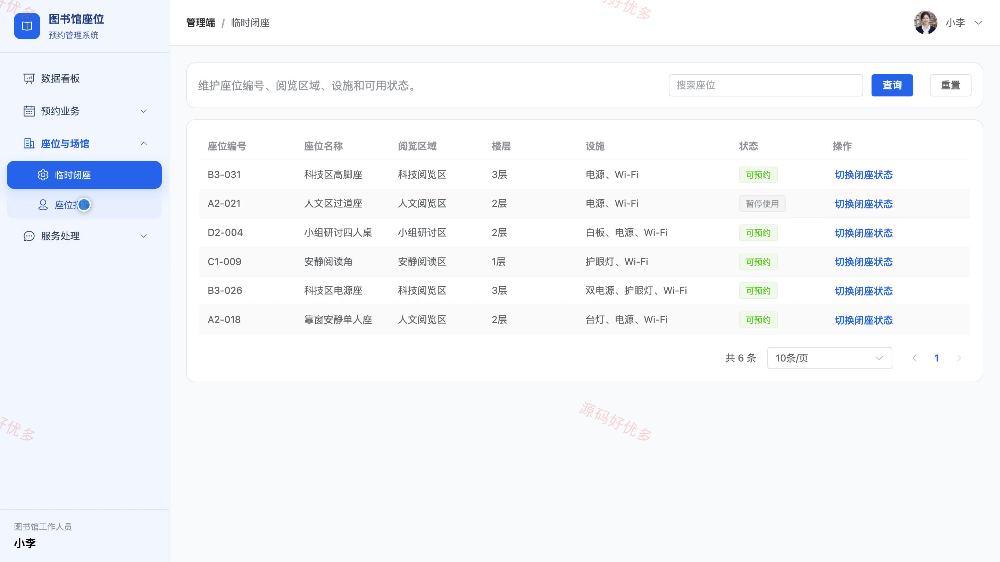
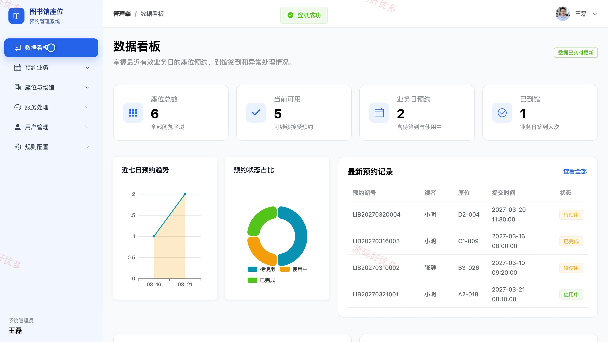
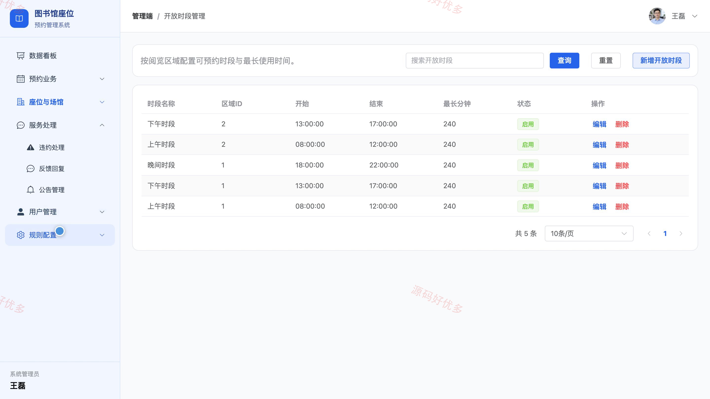

## 源码问题查看主页咨询

### 一、关键词
图书馆座位预约、自习室订座、阅览室预约、座位使用管理、到馆签到

### 二、作品包含
源码+数据库+万字设计文档+PPT+全套环境和工具资源+本地部署教程

### 三、项目技术
前端技术： Html、Css、Js、Vue3.4、Element-Plus
后端技术：Python、Django

### 四、运行环境要求
开发工具：PyCharm + VSCODE

数据库：MySQL5.7+（共13张表）

数据库管理工具：Navicat10以上版本

环境配置软件： Python3+

前端Nodejs：16+

浏览器：谷歌浏览器

### 五、项目介绍
项目编号：bs137C

本系统面向读者、图书馆工作人员和管理员，提供自习室座位查询与预约、到馆签到、违约处理及场馆资源管理，支持图书馆座位服务的日常协作。

角色：读者、图书馆工作人员、管理员

读者功能：账号注册与登录、按区域和时段查询座位、提交与取消座位预约、查看预约记录并签到、结束使用并释放座位、查看违约记录、查看公告并提交反馈、维护个人资料和密码。

图书馆工作人员功能：查看值班统计、核验预约并办理签到、办理离座并释放座位、临时闭座、处理违约记录、登记座位报障、查询预约记录、回复读者反馈。

管理员功能：查看预约与座位统计、管理读者和工作人员、维护场馆区域与座位、配置开放时段、配置预约与违约规则、管理预约记录、处理异常与反馈、发布馆内公告。

### 六、运行截图

